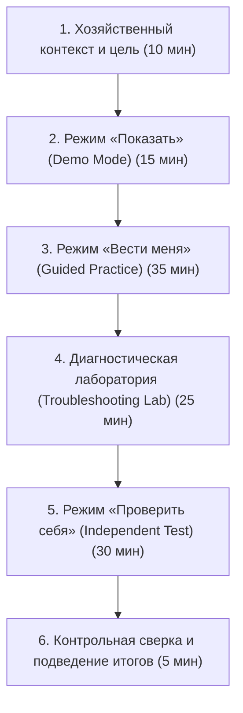

# STAGE 2 SPECIFICATION — Продажа по предоплате: счёт → оплата → реализация → контроль долга

**Версия:** 1.0.0  
**Дата:** 2026-10-15  
**Статус:** УТВЕРЖДЕНО К РЕАЛИЗАЦИИ (READY FOR CODER / ARENA)  
**Роль автора:** Продуктовый архитектор и методист 1C Tutor KZ  
**Ветка:** `agent/antigravity-sales-cycle-spec` (базовая ветка: `mpe/stage-1-validation`)  
**MPE disposition:** `EXTEND_EXISTING`  
**Канонический контекст:** Учебное занятие № 06 (120 минут) из `docs/curriculum/ACCOUNTING_KZ_SESSION_PLAN.md`, покрывающее навыки `AKZ-M03-L02`, `AKZ-M03-L03`, `AKZ-M03-L04` с интеграцией условий договоров (`AKZ-M03-L06`) и контроля взаиморасчетов (`AKZ-M03-L07`).

---

## 1. Контекст и решение владельца продукта (Owner Feedback)

### 1.1. Фиксация обратной связи владельца
По итогам проверки первого практического вертикального среза `AKZ-M03-L01` («Карточка покупателя», `/learn/customer-card`) зафиксировано решение владельца:
- **Вердикт:** Первый сценарий создания карточки покупателя успешно проверен, но признан **слишком простым** («детские вопросы / короткая изолированная форма»). Одно лишь сохранение контрагента не формирует у предпринимателя или начинающего бухгалтера целостного операционного навыка и не раскрывает коммерческий цикл.
- **Директива владельца:** Разрешить переход к следующему этапу реализации, при условии, что он будет спроектирован как **полноценное, насыщенное практическое занятие продолжительностью 90–120 минут**, а не короткая разрозненная форма.
- **Фундаментальное методическое ограничение:** Счёт на оплату (`Customer Invoice`) **не имеет права существовать изолированно** от факта получения денежных средств и отгрузки. Занятие обязано связывать весь контур: **Счёт → Поступление безналичной оплаты (аванс) → Реализация (ТМЗ + услуга) → Контроль закрытия взаиморасчётов (нулевое сальдо долга)**.
- **Недопустимость викторин:** Завершение занятия одним ответом, заполнением числового поля или единичным сохранением строго запрещено. Результат подтверждается исключительно детерминированным состоянием учебного окружения (`deterministic domain state`).

---

## 2. Хозяйственный кейс: Мебельный ИП в Казахстане (Fictional Data)

Все используемые реквизиты, наименования и суммы являются строго вымышленными учебными данными. Использование реальных ИИН/БИН, ЭЦП, паролей или банковских доступов запрещено.

### 2.1. Организация-продавец
- **Наименование:** ИП «Учебная Мебель KZ» (ИП Аскаров Б. С.)
- **Форма:** Индивидуальный предприниматель (резидент Республики Казахстан)
- **Руководитель:** Аскаров Бауржан Серикович
- **Налоговый режим:** Специальный налоговый режим (СНР) на основе упрощенной декларации
- **Статус по НДС:** Неплательщик НДС (освобождение по ст. 368 НК РК)
- **Город регистрации и ведения деятельности:** г. Астана
- **Расчетный счет:** `KZ789456123456789012` в АО «Учебный Банк Казахстана» (БИК: `UCHBKZ2A`)
- **Склад отгрузки:** «Основной склад готовой продукции» (г. Астана)

### 2.2. Покупатель (Контрагент)
- **Наименование:** ТОО «Офис Стиль Астана»
- **Вид контрагента:** Юридическое лицо (ТОО, резидент РК)
- **Учебный идентификатор (Non-regulatory):** `KZ-TRAIN-BIN-990101456789`
- **Город:** г. Астана, ул. Достык, 18
- **Роль в системе:** Покупатель офисной мебели для обустройства коммерческого офиса

### 2.3. Договор и условия расчётов
- **Наименование договора:** «Основной договор поставки № ОФ-26 от 01.10.2026»
- **Вид договора:** `С покупателем`
- **Валюта взаиморасчетов:** `KZT` (тенге)
- **Порядок ведения взаиморасчетов:** `По заказам/счетам` (детализация до расчетных документов)
- **Коммерческое условие:** 100% предварительная оплата безналичным банковским переводом до момента передачи товаров и выполнения сборочных работ

### 2.4. Спецификация заказа: товар + услуга (Номенклатурный состав)
Заказ включает в себя как материальную позицию (мебель), так и сопутствующую сервисную операцию (сборка/монтаж):

| № | Вид | Номенклатура | Ед. изм. | Кол-во | Цена за ед., KZT | Скидка | Сумма, KZT | Счета учета в РК |
|---|---|---|:---:|:---:|:---:|:---:|:---:|:---:|
| 1 | Товар | Стол офисный эргономичный "Комфорт-140" | шт. | 2 | 95 000 | 0% | 190 000 | 1330 (запас) / 6010 (доход) / 7010 (себестоимость) |
| 2 | Услуга | Доставка и профессиональная сборка офисной мебели | усл. | 1 | 35 000 | 0% | 35 000 | 6010 (доход от услуг) |
| **ИТОГО** | — | **Сумма счёта к оплате (без НДС)** | — | — | — | — | **225 000** | — |

*Примечание по скидке:* В базовом сценарии скидка составляет 0%. В альтернативной ветке тренировки допускается согласованная скидка 5 000 KZT на сборку (сумма 220 000 KZT) для проверки гибкости расчёта строчных данных.

### 2.5. Предоплата (Входящий платеж)
- **Документ:** «Платежное поручение входящее» (Поступление безналичных ДС)
- **Дата:** 02.10.2026
- **Вид операции:** `Оплата от покупателя`
- **Плательщик:** ТОО «Офис Стиль Астана»
- **Сумма платежа:** **225 000 KZT** (100% предоплата по Счёту № 1)
- **Документ-основание:** Счёт на оплату № 1 от 01.10.2026
- **Назначение платежа:** «100% предоплата за мебель и сборку по счету № 1 от 01.10.2026, без НДС»
- **Бухгалтерский смысл операции в РК:** 
  Поступление денег до отгрузки признается авансом покупателя. Возникает кредиторская задолженность ИП перед заказчиком:
  - Дебет 1030 («Денежные средства на текущих банковских счетах»)
  - Кредит 3510 («Краткосрочные авансы полученные») на сумму 225 000 ₸.

### 2.6. Реализация (Отгрузка и акт выполненных работ)
- **Документ:** «Реализация ТМЗ и услуг» № 1
- **Дата:** 05.10.2026 (после подтверждения зачисления оплаты)
- **Вид операции:** `Товары, услуги, комиссия`
- **Документ-основание:** Счёт на оплату № 1 от 01.10.2026
- **Состав табличных частей:**
  - Вкладка «Товары»: 2 шт. «Стол офисный эргономичный "Комфорт-140"» на сумму 190 000 ₸.
  - Вкладка «Услуги»: 1 усл. «Доставка и профессиональная сборка офисной мебели» на сумму 35 000 ₸.
- **Итоговая сумма реализации:** **225 000 KZT**.
- **Статус документа:** `Проведён` (`isPosted: true`).
- **Бухгалтерский смысл операции в РК:**
  1. Признание дохода от реализации: Дебет 1210 — Кредит 6010 на 225 000 ₸.
  2. Зачёт ранее полученного аванса: Дебет 3510 — Кредит 1210 на 225 000 ₸.
  3. Списание запасов со склада: Дебет 7010 — Кредит 1330 (в учебной модели).

### 2.7. Контроль остатка задолженности (Debt Balance / Settlement Ledger)
- **Сальдо расчётов на начало операции:** 0 ₸.
- **Оборот по оплате (Кредит 3510/1210):** 225 000 ₸.
- **Оборот по реализации (Дебет 1210):** 225 000 ₸.
- **Конечный остаток долга (Net Debt):** **0 KZT**. Обязательства полностью исполнены обеими сторонами.
- **Контрольное сальдо в проверочном отчете (Акт сверки / Карточка расчетов):** 
  - Задолженность покупателя перед ИП = 0 ₸.
  - Задолженность ИП перед покупателем = 0 ₸.

---

## 3. Методическая структура занятия на 120 минут

Занятие строится строго по стандарту substantial-сессий `ACCOUNTING_KZ_SESSION_PLAN.md`:



### 3.1. Фаза 1: Хозяйственный контекст и бизнес-задача (10 минут)
- Почему мебельный бизнес в РК работает по предоплате: кассовые разрывы, закупка комплектующих под заказчика.
- Разбор схемы документооборота:
  `Счёт (оферта) → Выписка банка (факт поступления ДС) → Накладная/Акт (переход права собственности) → Зачёт аванса`.
- Обозначение критериев успешного выполнения: все три документа созданы, связаны и проведены; сальдо взаиморасчетов сошлось в 0.

### 3.2. Фаза 2: Режим «Показать» (Demo Mode) (15 минут)
- Полноэкранная демонстрация сквозной цепочки без выставления итоговой оценки (`isScored: false`).
- Ученик может запустить непрерывное воспроизведение или использовать пошаговый переход с кнопкой `Показать действие` (Show Action).
- Акцентирование внимания на ключевых связках: выбор договора с признаком «С покупателем», ввод платежа на основании счёта, автоматический перенос строк в реализацию.

### 3.3. Фаза 3: Режим «Вести меня» (Guided Practice) (35 минут)
- Интерактивное пошаговое выполнение учеником всей цепочки в Training Workspace.
- Сопровождение контекстным коучем и бирюзовым маяком Driver.js (`#0f9f9a`) на целевых элементах (`data-training-target`).
- Переход к следующему шагу выполняется **исключительно по факту достижения требуемого состояния модели** (`advanceWhen(state)`), а не по простому клику «Далее».
- Доступна трехуровневая поддержка на каждом шаге:
  1. Кнопка `Почему?` (методическое объяснение 1С-логики);
  2. `Подсказка 1` (наводящий вопрос или ориентир в интерфейсе);
  3. `Подсказка 2` (точное наименование поля и значение);
  4. `Показать действие` (выполняет действие в среде, фиксируя assisted-попытку).

### 3.4. Фаза 4: Лаборатория диагностических ошибок (25 минут)
Ученик сталкивается с тремя классическими ошибками бухгалтера/предпринимателя, учится локализовать их в интерфейсе и исправлять:
1. Ошибка контрагента/договора;
2. Ошибка расхождения сумм счёта и оплаты;
3. Ошибка потери связи документов или отсутствия проведения.
(Подробное описание ошибок приведено в разделе 5).

### 3.5. Фаза 5: Режим «Проверить себя» (Independent Test) (30 минут)
- Контрольный срез на независимых входных данных (вариативный кейс).
- Все маяки, стрелки, подсветки и подсказки коуча **отключены**.
- На панели задачи отображаются только исходные условия и кнопка `Проверить работу`.
- Кнопка `Проверить работу` вызывает Verification Engine v2 и формирует прозрачный протокол проверки по 18 детерминированным условиям.
- Выполнение без подсказок фиксирует `completed_unassisted`.

### 3.6. Фаза 6: Разбор контрольного отчёта и фиксация компетенции (5 минут)
- Просмотр отчета «Акт сверки взаиморасчетов» / «Оборотно-сальдовая ведомость по счету 1210/3510».
- Ответ на методический вопрос: почему при получении аванса возникает обязательство 3510 и как оно закрывается при проведении реализации.

---

## 4. Проектирование режимов обучения (Demo / Guided / Test)

| Параметр | Режим «Показать» (Demo) | Режим «Вести меня» (Guided) | Режим «Проверить себя» (Independent Test) |
|---|---|---|---|
| **Цель** | Наглядное понимание сквозного цикла | Отработка моторных и интерфейсных навыков | Аттестация самостоятельного выполнения |
| **Бирюзовый маяк Driver.js** | Активен (подсвечивает шаги сценария) | Активен (показывает текущий целевой контрол) | **Отключен** |
| **Боковая панель коуча** | Демонстрирует ход процесса | Показывает инструкцию, `Почему?`, подсказки | Скрыта (отображается только карточка задачи) |
| **Кнопка «Показать действие»** | Доступна на каждом шаге | Доступна (переводит попытку в `assisted`) | **Заблокирована / скрыта** |
| **Автоматическое продвижение** | Возможно по кнопке шага | Только при выполнении условия состояния | Отсутствует |
| **Оценивание (Scoring)** | Не оценивается (`isScored = false`) | Оценивается (`completed_assisted` при подсказках) | Строго оценивается (`completed_unassisted` при 0 подсказок) |
| **Сброс (Reset)** | Возврат в начало демонстрации | Сброс среды к исходному seed-состоянию | Сброс среды к новому контрольному варианту данных |

---

## 5. Лаборатория диагностических ошибок (Troubleshooting Lab)

Спецификация включает обязательные сценарии диагностики трех типовых ошибок. Ученик обязан обнаружить ошибку по симптомам в среде и устранить её.

### 5.1. Диагностическая ошибка № 1: Неверный покупатель или договор
- **Проявление:** В документе поступления оплаты или в накладной реализации выбран другой контрагент (например, созданный в первом уроке `ТОО Учебный Покупатель` вместо `ТОО Офис Стиль Астана`) либо выбран договор с несоответствующим видом (например, «С поставщиком» вместо «С покупателем»).
- **Симптом в 1С / Training Workspace:**
  - В платёжном документе невозможно выбрать Счёт на оплату № 1 в качестве основания расчётов (список счетов пуст, так как фильтруется по выбранному контрагенту).
  - В отчёте по расчётам у `ТОО Офис Стиль Астана` висит непогашенный дебиторский долг, а у другого контрагента висит неопознанный аванс.
- **Диагностический Assertion:**
  - `assert:payment:customer_match` -> **FAIL**: *«Плательщик в банковском поступлении не соответствует покупателю в счёте на оплату».*
  - `assert:payment:contract_type` -> **FAIL**: *«Вид договора должен быть "С покупателем", а не "С поставщиком"».*
- **Протокол устранения:** Ученик возвращается в документ, выбирает правильного покупателя `ТОО Офис Стиль Астана`, выбирает договор «Основной договор поставки № ОФ-26», сохраняет и перепроводит цепочку.

### 5.2. Диагностическая ошибка № 2: Несовпадение суммы оплаты и счёта
- **Проявление:** Покупатель оплатил счёт частично (например, 190 000 ₸ за столы, забыв оплатить 35 000 ₸ за сборку) либо при вводе выписки оператор ошибся в сумме (ввёл 200 000 ₸ или допустил опечатку в нулях).
- **Симптом в 1С / Training Workspace:**
  - Счёт на оплату окрашивается в статус «Оплачен частично» (с бейджем неполной оплаты).
  - При проведении реализации на полную сумму (225 000 ₸) зачёт аванса происходит только на сумму 190 000 ₸.
  - В отчёте по расчётам остаётся дебиторская задолженность покупателя перед ИП: **35 000 KZT**.
- **Диагностический Assertion:**
  - `assert:payment:amount_match` -> **FAIL**: *«Сумма оплаты (190 000 ₸) не покрывает полную сумму счёта (225 000 ₸). Остаток долга: 35 000 ₸».*
  - `assert:settlement:final_balance_zero` -> **FAIL**: *«Расчёты по сделке не закрыты в ноль. Сальдо: 35 000 ₸».*
- **Протокол устранения:** Ученик сверяет строки счёта с суммой выписки, находит недостающую позицию (сборка 35 000 ₸), корректирует сумму платежа до 225 000 ₸ и добивается нулевого конечного сальдо.

### 5.3. Диагностическая ошибка № 3: Реализация без требуемой связи со счётом/предоплатой или с неверным статусом
- **Проявление:** Документ реализации создан как обособленный черновик (не заполнено поле `Документ-основание / Счёт`), либо реализация создана до момента проведения оплаты, либо документ сохранён без проведения (`status = 'draft'`, `isPosted = false`).
- **Симптом в 1С / Training Workspace:**
  - В дереве подчиненных документов («Связанные документы») реализация не отображается в ветке счёта.
  - Счёт остаётся в статусе «Не отгружен» (или «Оплачен, но не закрыт»).
  - В регистре взаиморасчетов сумма реализации начислена независимо от полученного аванса: у покупателя одновременно отображается долг 225 000 ₸ по отгрузке и висит незачтенный аванс 225 000 ₸ на счете 3510 (задвоение оборотов без зачёта).
- **Диагностический Assertion:**
  - `assert:realization:invoice_basis` -> **FAIL**: *«Документ реализации не привязан к счёту-основанию. Автоматический зачёт аванса не произошёл».*
  - `assert:realization:posted` -> **FAIL**: *«Документ реализации сохранён как черновик, но не проведён. Движения по отгрузке отсутствуют».*
- **Протокол устранения:** Ученик открывает реализацию, заполняет связь со Счётом № 1, нажимает «Провести и закрыть» (`isPosted = true`), после чего система автоматически связывает зачёт аванса.

---

## 6. Детерминированное состояние среды (Deterministic Domain State)

Вся логика модели выносится в чистый TypeScript-домен без привязки к React.

### 6.1. Модель данных (Domain Entities)

```typescript
export type TrainingMode = "demo" | "guided" | "test";

export type DocumentLifecycleStatus = "draft" | "saved" | "posted";

export type InvoicePaymentStatus = "unpaid" | "partially_paid" | "paid";

export type NomenclatureKind = "goods" | "service";

export interface TrainingNomenclatureItem {
  id: string;
  name: string;
  kind: NomenclatureKind;
  unit: string;
  defaultPrice: number;
}

export interface TrainingContract {
  id: string;
  counterpartyId: string;
  number: string;
  date: string;
  kind: "customer" | "supplier";
  currency: "KZT";
  settlementTerms: "by_orders" | "by_contract_total";
}

export interface TrainingInvoiceLine {
  id: string;
  itemId: string;
  itemName: string;
  kind: NomenclatureKind;
  quantity: number;
  unitPrice: number;
  discountPercent: number;
  totalSum: number;
}

export interface TrainingCustomerInvoice {
  id: string;
  number: string;
  date: string;
  counterpartyId: string;
  contractId: string;
  lines: TrainingInvoiceLine[];
  totalSum: number;
  status: DocumentLifecycleStatus;
  paymentStatus: InvoicePaymentStatus;
}

export interface TrainingBankPayment {
  id: string;
  number: string;
  date: string;
  operationKind: "incoming_customer";
  counterpartyId: string;
  contractId: string;
  invoiceId?: string; // Связь со счётом
  bankAccount: string;
  amount: number;
  purpose: string;
  status: DocumentLifecycleStatus; // 'posted' = платёж зарегистрирован и разнесён
}

export interface TrainingRealizationLine {
  id: string;
  itemId: string;
  itemName: string;
  kind: NomenclatureKind;
  quantity: number;
  unitPrice: number;
  totalSum: number;
}

export interface TrainingRealization {
  id: string;
  number: string;
  date: string;
  counterpartyId: string;
  contractId: string;
  invoiceId?: string; // Документ-основание
  warehouseId: string;
  goodsLines: TrainingRealizationLine[];
  serviceLines: TrainingRealizationLine[];
  totalSum: number;
  status: DocumentLifecycleStatus; // 'posted' = проведена отгрузка и акт
}

export interface TrainingSettlementLedger {
  counterpartyId: string;
  contractId: string;
  totalInvoiced: number;
  totalPaidAdvance: number;
  totalRealized: number;
  advanceOffsetAmount: number;
  customerReceivableBalance: number; // Дебет 1210 (долг покупателя)
  customerAdvanceBalance: number;    // Кредит 3510 (аванс покупателя)
  netBalance: number;                // Чистое сальдо (0 = закрыто)
}

export interface SalesCycleScenarioState {
  screen: 
    | "home"
    | "sales-menu"
    | "invoices-list"
    | "invoice-form"
    | "banking-menu"
    | "payments-list"
    | "payment-form"
    | "realizations-list"
    | "realization-form"
    | "settlement-report";
  
  organization: {
    id: string;
    name: string;
    bankAccount: string;
  };

  catalogNomenclature: TrainingNomenclatureItem[];
  contracts: TrainingContract[];
  
  invoices: TrainingCustomerInvoice[];
  payments: TrainingBankPayment[];
  realizations: TrainingRealization[];
  
  activeInvoiceDraft: Partial<TrainingCustomerInvoice> | null;
  activePaymentDraft: Partial<TrainingBankPayment> | null;
  activeRealizationDraft: Partial<TrainingRealization> | null;
  
  actionLog: Array<{
    timestamp: string;
    action: string;
    payload?: Record<string, unknown>;
  }>;
}
```

### 6.2. Исходное seed-состояние (Pre-seeded State)
В начальном состоянии сценария:
- Создана организация: ИП «Учебная Мебель KZ».
- Создан покупатель: ТОО «Офис Стиль Астана».
- Создан договор: «Основной договор поставки № ОФ-26 от 01.10.2026» (вид `customer`).
- В справочнике номенклатуры уже присутствуют:
  1. `item-table-comfort`: «Стол офисный эргономичный "Комфорт-140"» (вид: `goods`, цена: 95 000 ₸).
  2. `item-service-assembly`: «Доставка и профессиональная сборка офисной мебели» (вид: `service`, цена: 35 000 ₸).
- Списки документов (`invoices`, `payments`, `realizations`) пусты.
- Сальдо взаиморасчетов = 0 ₸.

---

## 7. Каталог детерминированных условий проверки (PASS/FAIL Assertions)

Проверка практического выполнения опирается на 18 обязательных условий. Завершение считается успешным (**PASS**) только тогда, когда **каждое из 18 условий** вернуло `passed = true`.

### Группа 1: Счёт на оплату (Invoice Assertions)
1. `assert:invoice:exists` — Счёт на оплату создан в системе (`invoices.length === 1`).
2. `assert:invoice:counterparty` — В счёте выбран покупатель `ТОО Офис Стиль Астана`.
3. `assert:invoice:contract` — В счёте выбран договор № ОФ-26 с признаком `customer`.
4. `assert:invoice:lines_count` — В табличной части присутствуют ровно 2 строки (товар и услуга).
5. `assert:invoice:goods_line` — Строка товара: позиция «Стол офисный эргономичный "Комфорт-140"», количество 2 шт., цена 95 000 ₸, сумма 190 000 ₸.
6. `assert:invoice:service_line` — Строка услуги: позиция «Доставка и профессиональная сборка офисной мебели», количество 1 усл., цена 35 000 ₸, сумма 35 000 ₸.
7. `assert:invoice:total_sum` — Итоговая сумма счёта рассчитана строго по строкам и равна **225 000 KZT**.
8. `assert:invoice:status` — Счёт сохранён в системе (`status === 'saved'` или `'posted'`).

### Группа 2: Поступление безналичной оплаты (Bank Payment Assertions)
9. `assert:payment:exists` — Зарегистрирован входящий платёж от покупателя.
10. `assert:payment:operation_kind` — Вид операции платежа — `incoming_customer` («Оплата от покупателя»).
11. `assert:payment:counterparty_and_contract` — Плательщик и договор совпадают со счётом на оплату.
12. `assert:payment:invoice_link` — Платёж содержит ссылку на созданный Счёт на оплату № 1 в качестве документа расчетов.
13. `assert:payment:amount_match` — Сумма платежа равна сумме счёта: **225 000 KZT** (100% аванс).
14. `assert:payment:status_posted` — Банковский платёж проведён/зарегистрирован (`status === 'posted'`).

### Группа 3: Реализация ТМЗ и услуг (Realization Assertions)
15. `assert:realization:exists` — Создан документ реализации ТМЗ и услуг.
16. `assert:realization:invoice_basis` — В качестве документа-основания реализации указан Счёт № 1.
17. `assert:realization:lines_match` — Состав и количество номенклатуры в накладной и акте точно соответствуют счёту (2 стола + 1 сборка на сумму 225 000 ₸).
18. `assert:realization:status_posted` — Документ реализации проведён (`status === 'posted'`).

### Группа 4: Взаиморасчёты и безопасность (Settlement & Safety Assertions)
19. `assert:settlement:advance_offset` — Сумма полученного аванса (225 000 ₸) в полном объёме зачтена в счет закрытия отгрузки.
20. `assert:settlement:final_balance_zero` — Конечное сальдо расчётов равно **0 KZT** (нет непокрытого долга и незакрытого аванса).
21. `assert:safety:no_real_credentials` — В журналах и реквизитах отсутствуют реальные ИИН/БИН, реальные банковские ключи или закрытые данные.

---

## 8. Модель оценивания, сброса и повторных попыток

### 8.1. Градация результатов (Assisted / Unassisted Scoring)
Практический результат оценивается системой на основе использованной помощи:
- `completed_unassisted` (**Независимое выполнение**):
  - Режим `test` («Проверить себя»);
  - 100% условий (18 из 18) вернули `passed = true`;
  - `hintCount === 0` (подсказки уровня 1 и 2 не открывались);
  - `showActionCount === 0` (кнопка «Показать действие» не нажималась).
- `completed_assisted` (**Выполнение с подсказками**):
  - Режим `guided` или `test`;
  - 100% условий вернули `passed = true`;
  - Ученик открывал `Подсказку 1`, `Подсказку 2` либо воспользовался `Показать действие`.
- `not_completed` / `needs_retry` (**Не завершено / требуется исправление**):
  - Одно или более условий вернули `passed = false`.
  - Отображается детальный диагностический протокол с указанием первого ошибочного узла и корректирующего совета.

### 8.2. Механика сброса (Reset Protocol)
- Кнопка «Начать заново» (`Reset`):
  - Мгновенно возвращает состояние рабочей области к предопределенному начальному состоянию (`seed-state`).
  - Очищает все созданные черновики документов.
  - Инкрементирует счетчик `resetCount` в структуре прогресса.
  - Сбрасывает текущий шаг подсказки до 0.
- Непрерывность сессии: сброс состояния Training Workspace не сбрасывает общую статистику времени сессии, фиксируя факт поиска решения.

---

## 9. Соответствие Knowledge Atlas и пробелы Interface Passport

### 9.1. Узлы графа Atlas (Knowledge Atlas Nodes)
Спецификация напрямую связывается с официальным онтологическим графом знаний:
- `workflow:accounting-kz:3.0:customer-invoice` (Оформление счета покупателю);
- `workflow:accounting-kz:3.0:customer-bank-payment` (Регистрация безналичной оплаты от покупателя);
- `workflow:accounting-kz:3.0:realization-goods-services` (Реализация ТМЗ и услуг);
- `workflow:accounting-kz:3.0:customer-settlement-control` (Контроль расчетов и акт сверки).

### 9.2. Доказательная база (Evidence Records)
- `evidence:accounting-kz:stage1b:trade-sequence:2026-08-15` (**Grade A**): Подтверждает каноничность цепочки торговых операций по предварительной оплате в редакции 3.0 (глава 7 ИТС КЗ).
- `evidence:accounting-kz:counterparty-contracts:2026-08-15` (**Grade A**): Подтверждает обязательность ведения расчетов в разрезе договоров контрагентов.
- `evidence:accounting-kz:realization:2026-08-15` (**Grade A**): Подтверждает разделение материальных ТМЗ и нематериальных услуг в документе реализации.
- `evidence:accounting-kz:customer-settlements-reporting:2026-08-15` (**Grade A**): Подтверждает формирование регистров взаиморасчетов и автоматический зачёт авансов.
- `evidence:accounting-kz:taxi-configurable-ui:2026-08-15` (**Grade B**): Констатирует настраиваемость интерфейса «Такси», запрещая жесткую привязку к пиксельным координатам.

### 9.3. Пробелы интерфейсных паспортов (Interface Passport Gaps)
До момента получения протокола физического наблюдения запущенной базы (`EXACT_UI_OBSERVATION`):
- Разрешено использовать семантические идентификаторы контролов (`sales.invoices.create`, `invoice.header.customer`, `invoice.lines.add`, `payment.register`, `realization.post`).
- Запрещено придумывать произвольные нестандартные кнопки, перегруженные меню или нетипичные цвета.
- Интерфейс Training Workspace должен использовать типовой стиль 1С «Такси» (серый фон панелей `#f2f2f2`, желтая полоса активности `#f5a623`, фирменная бирюзовая индикация фокуса коуча `#0f9f9a`).

---

## 10. Критерии приёмки для инженера (Acceptance Criteria for Coder)

Кодер (или Arena) обязан руководствоваться следующими критериями готовности:

1. [ ] **MPE Disposition EXTEND_EXISTING:** Код расширяет существующую структуру `src/features/training-workspace/`, не создавая параллельных библиотек и не переписывая приложение.
2. [ ] **Строгое отсутствие викторин:** Завершение урока невозможно текстовым вводом суммы или ответом на вопрос. Проверка считывает только состояние документов в доменном хранилище.
3. [ ] **Реализация всех трех режимов:** 
   - `Показать`: сквозной пошаговый просмотр без выставления оценки.
   - `Вести меня`: Driver.js бирюзовый маяк (`#0f9f9a`) на целевых элементах, пошаговые подсказки (`Почему?`, Hint 1, Hint 2, Show Action).
   - `Проверить себя`: независимое выполнение без коуча.
4. [ ] **Три диагностические ошибки:** Реализованы сценарии намеренной ошибки (неверный договор/контрагент, сумма оплаты != сумма счёта, реализация без связи/проведения) с понятными объяснениями и возможностью исправления.
5. [ ] **Связность цепочки:** Счёт, оплата и реализация связаны между собой идентификаторами `invoiceId` и `contractId`. Расчёт задолженности автоматически уменьшает сальдо до нуля при полной цепочке.
6. [ ] **Инженерные тесты:**
   - Unit-тесты проверяют доменный редьюсер, проверку всех 18 ассертов, позитивные сценарии и все 3 ошибки.
   - Playwright E2E-тесты проверяют десктоп (`1440x900`) и мобильный вьюпорт (`360x800`).
7. [ ] **Безопасность:** Баннер `УЧЕБНАЯ СРЕДА — НЕ 1С` отображается постоянно; валидация блокирует ввод реальных ИИН/БИН.
8. [ ] **Все инженерные проверки PASS:** `npm run lint`, `npm run typecheck`, `npm run test`, `npm run check:curriculum`, `npm run check:secrets`.

---

## 11. Реестр файлов, разрешенных к изменению для Arena (File Whitelist)

Arena разрешено создавать и модифицировать **только следующие файлы**:

### Разрешено изменять/создавать:
1. `src/features/training-workspace/domain/salesCycleScenario.ts` — доменная модель, типы, команды и чистый редьюсер цепочки продажи.
2. `src/features/training-workspace/domain/salesCycleVerification.ts` — реализация 18 детерминированных ассертов.
3. `src/features/training-workspace/domain/salesCycleScenario.test.ts` — unit-тесты домена, ассертов и диагностических ошибок.
4. `src/features/training-workspace/guidance/salesCycleGuidance.ts` — конфигурация шагов коуча и условий продвижения.
5. `src/features/training-workspace/SalesCycleTrainingWorkspace.tsx` — визуальный компонент рабочей области (таблицы счёта, оплаты, реализации, отчёт по расчётам).
6. `src/features/training-workspace/training-workspace.css` — стили форм документов (счета, платежа, реализации, табличных частей).
7. `src/routes/LessonPage.tsx` — подключение нового практического тренажёра к маршрутизатору уроков.
8. `src/content/course.json` — актуализация метаданных урока № 06.
9. `e2e/sales-cycle-workspace.spec.ts` — Playwright тесты для режимов Guided и Test (десктоп и мобильный).
10. `docs/curriculum/LESSON_STATUS.md` — фиксация статуса этапа в ходе инженерного выполнения.
11. `SESSION_NOTES.md` — рабочий журнал сессии кодера.

### Строго запрещено изменять:
- `package.json` и `package-lock.json` (запрещено добавлять новые внешние зависимости).
- `minibase/` (не трогать локальный контур MiniBase).
- `functions/` (серверная часть Cloudflare Pages Functions неизменна).
- `FOUNDATION.md`, `AGENTS.md` (базовые конституционные правила неизменны).
- Запрещено подключать внешние базы данных (Supabase/Postgres), AI-библиотеки или внешние API реальной 1С.
